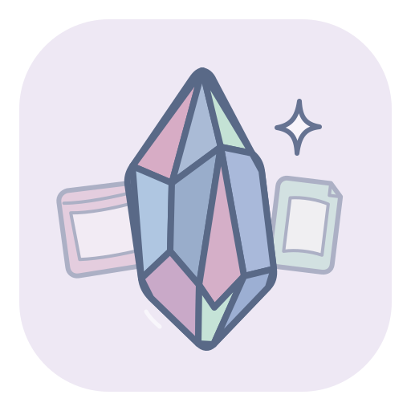
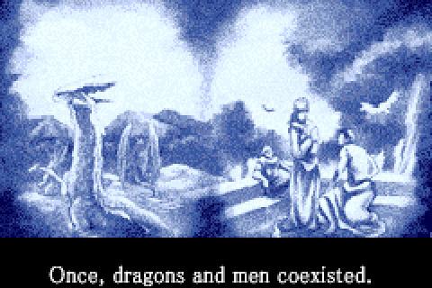
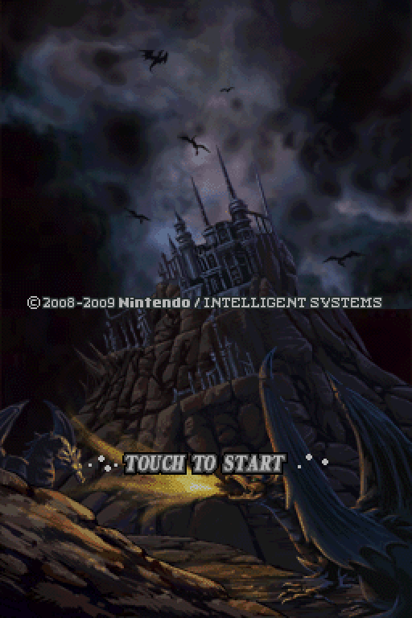
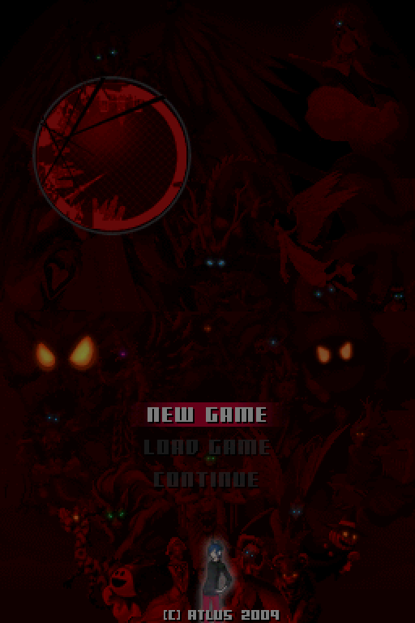

<div align="center">



# emuGBDS

**A clean-room Game Boy Advance and Nintendo DS emulator, written from scratch in C++17.**

[](https://github.com/Shrxmy/emuGBDS/releases/latest)
[](LICENSE)


&nbsp;
&nbsp;


<sub>Fire Emblem (GBA) · Fire Emblem: Shadow Dragon (DS) · Devil Survivor (DS, 3D engine)</sub>

</div>

Both cores are in-house: every piece of hardware is written from documentation
([GBATEK](https://problemkaputt.de/gbatek.htm)) and observed behaviour, never from
another emulator's source. See [`CLEAN_ROOM_POLICY.md`](CLEAN_ROOM_POLICY.md).

## Features

**Game Boy Advance**
- ARM7TDMI with real instruction timings (memory waitstates, WAITCNT, multiplies, branches).
- Video (all BG modes, sprites, windows, blending), sound (Direct Sound and the four PSG channels), timers, DMA.
- Cartridge saves (SRAM/FRAM, FLASH 64K/128K, EEPROM) and the real-time clock.

**Nintendo DS**
- ARM9 and ARM7 with cycle timing, CP15, the math unit, IPC, timers, DMA and the RTC.
- Both 2D engines, display capture, and the **3D engine**: geometry, lighting, clipping,
  textures in every format, toon/highlight shading and translucency.
- All 16 sound channels with capture; touchscreen; save chips.
- Boots the **real DS menu** from your BIOS and firmware, with a card in Slot-1 and a GBA
  cartridge in Slot-2 (it can start either, as on hardware). Games can also boot directly.

**App**
- SDL2 + Dear ImGui window: open a ROM from the menu or drop it on the window.
- Pause, frame step, fast-forward, window scale, DS screen layouts, fullscreen.
- Keyboard and gamepad (hot-plug), all rebindable; volume and mute.
- Debug panels: live CPU/IO state, layer toggles, screenshots, memory dumps.

**Not yet:** 3D fog, edge marking, anti-aliasing and shadow polygons; DS Wi-Fi (stubbed);
save states.

## Getting started

1. Download `emuGBDS-<version>-windows-x64.zip` from
   [Releases](https://github.com/Shrxmy/emuGBDS/releases) and unzip it anywhere. No
   installer or Visual C++ runtime is needed.
2. Add your own BIOS and firmware dumps (none are included). Either set them in
   **Settings > BIOS & boot**, or place them next to `emugbds.exe`:

   ```
   emugbds.exe
   bios\
     gb-bios\gba_bios.bin        GBA BIOS
     nds-bios\biosnds7.bin       DS ARM7 BIOS
     nds-bios\biosnds9.bin       DS ARM9 BIOS
     nds-bios\dsfirmware.bin     DS firmware (needed for the DS menu)
   ```

   The `bios\` folder is also found in the working folder or up to two folders above the exe.
3. Run `emugbds.exe` and pick a game with **File > Open ROM** (`Ctrl+O`), or drag a `.gba`
   or `.nds` file onto the window.

### The DS menu and both slots

**File > Slot-1 card** and **File > Slot-2 cartridge** choose the cartridges, and
**File > Start DS menu** boots the real menu, which can start the DS game or the GBA game.
A DS game also sees the Slot-2 cartridge and its save, as Pokémon Diamond/Pearl/Platinum
need for Pal Park.

### Where things are saved

| What | Where |
|---|---|
| Game saves | `<rom>.sav` next to each ROM |
| DS firmware settings (name, birthday, language, touch calibration) | `dsfirmware.sav` next to your firmware dump; the dump itself is never modified |
| App settings | `emugbds.ini` next to the exe |
| Screenshots (BMP) and memory dumps | `screenshots\` and `dumps\` next to the exe |

## Controls

| Console | Keyboard | Gamepad |
|---|---|---|
| A / B | `Z` / `X` | right / bottom face button |
| X / Y (DS) | `D` / `C` | top / left face button |
| L / R | `A` / `S` | shoulders |
| Start / Select | `Enter` / `Right Shift` | Start / Back |
| D-pad | arrow keys | D-pad or left stick |
| Touchscreen (DS) | left mouse button on the bottom screen | — |

Face buttons go by position, as on a Nintendo pad. Keys and buttons can be changed in
**Settings > Controls**.

| Hotkey | Action |
|---|---|
| `Ctrl+O` / `Ctrl+R` | open ROM / reset |
| `P` / `N` | pause / step one frame while paused |
| hold `Tab` (or right trigger) | fast-forward |
| `M` | mute |
| `F1` | CPU/IO panel |
| `F11` / `F12` | fullscreen / screenshot |
| `Esc` | leave fullscreen, or quit when windowed |

## Command line

```powershell
emugbds.exe game.gba                                   # start a game
emugbds.exe game.nds --slot2 game.gba                  # DS game with a GBA cartridge in Slot-2
emugbds.exe --ds-menu --nds game.nds --slot2 game.gba  # the real DS menu with both slots
emugbds.exe --mode ds --slot2 game.gba --interactive   # DS menu with only the GBA cartridge
emugbds.exe game.gba --frames 600 --debug-stats        # run headless and print state
```

`--frames N` runs headless for N frames (add `--interactive` to keep the window); `--uncapped`
removes the speed limit. BIOS paths can be given with `--bios-gba`, `--bios-nds7`,
`--bios-nds9` and `--firmware-nds`. Without the DS BIOS and firmware, the DS menu boot is
simulated and switches straight to the Slot-2 game. `emugbds.exe --help` lists every option.

## Building from source

Requires Windows, Visual Studio 2022 (MSVC) and CMake 3.20 or newer. SDL2 is vendored in `sdl/`.

```powershell
cmake --preset msvc-release
cmake --build --preset build-msvc-release
ctest --test-dir .\build -C Release --output-on-failure
```

The app is `build\Release\emugbds.exe`. To make the release zip, run `cpack -G ZIP -C Release`
inside `build\`.

New to the code? Start with [`docs/README.md`](docs/README.md), then
[`docs/ARCHITECTURE.md`](docs/ARCHITECTURE.md). Contributions: [`CONTRIBUTING.md`](CONTRIBUTING.md).
Changes per version: [`CHANGELOG.md`](CHANGELOG.md).

## License

emuGBDS is released under the [MIT License](LICENSE). Bundled third-party code (SDL2,
Dear ImGui) keeps its own license; see [`THIRD_PARTY_NOTICES.md`](THIRD_PARTY_NOTICES.md).

No BIOS, firmware or game files are included or distributed; use dumps of hardware and games
you own. `bios/` and `roms/` are git-ignored for local files. Game names and screenshots are
shown only to illustrate compatibility; they belong to their respective owners.
